# PPT 风格编号库

251 套 PPT 设计风格，每一套都有整页效果图和编号。挑中一个编号，把它的来源和配色交给 AI，整份 PPT 或 HTML 课件的风格就能一次换掉。

- **网页版（推荐）**：https://jingzuozoe-bot.github.io/ppt-style-library/ ：一页看完，可按分组、深浅底色、来源筛选，卡片上一键复制。
- **单页总表**：[配色编号总表.pdf](配色编号总表.pdf)，251 张效果图印在一页上。
- **切换手册**：[设计风格切换手册.md](设计风格切换手册.md)，技能和库的地址、全部编号对照、换风格的方法。
- **数据文件**：[配色编号.json](配色编号.json)，同一套编号的机器可读版，AI 可以直接读取。

## 三步换风格

1. **挑**：往下翻或打开网页版，看效果图挑一个编号，比如 `P04`、`I09`、`T41`。
2. **查**：在网页版点"复制来源"，或者在手册、JSON 里按编号查，拿到源文件链接和主色。
3. **换**：把下面的提示词连同复制的内容发给 AI（Claude Code、Codex、WorkBuddy 都行）。用 PowerPoint 的，按手册第七节"PowerPoint 主题色对照"手动填颜色。

```text
请把这份课件的设计风格换成【编号】。
这个编号的来源和配色如下：【粘贴复制的内容】
要求：
1. 只改样式（颜色、字体、版式装饰、动效），一个字都不改文字内容和页序。
2. P 和 I 开头的编号，先看它的源文件或官方图，连版式、字体、装饰一起照着做；T 开头的只换颜色，按 底、面、墨、灰、强调、章节色块 分配。
3. 保留现有的翻页、全屏和其他交互。
4. 改完逐页截图自查：没有文字溢出、遮挡，深色底上的字看得清。
5. 字体只用系统自带的，保证断网能放。
```

## 编号怎么分

| 分组 | 数量 | 是什么 | 来源 |
|---|---|---|---|
| P01–P171 | 171 | GitHub 高星 HTML 幻灯片项目里的真实模板，图为模板原样第一页；P01–P14 是"高端商业、颜色活泼"的精选 | html-ppt-skill、oh-my-ppt、beautiful-html-templates、guizang-ppt-skill、huashu-design |
| I01–I24 | 24 | impeccable 设计技能的"视觉世界"，图为官方效果图 | impeccable |
| T01–T56 | 56 | taste-skill 配色库，同一张封面只换颜色，用来比颜色 | taste-skill |

详细的来源和许可见 [致谢与许可.md](致谢与许可.md)。

## P01–P171　高星模板

<table>
<tr><td align="center" width="25%"><a href="效果图/P/P01_pitch-deck.jpg">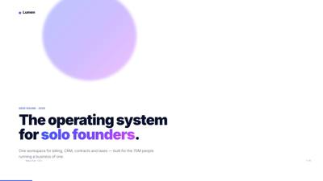</a><br><b>P01</b> 融资路演</td><td align="center" width="25%"><a href="效果图/P/P02_product-launch.jpg">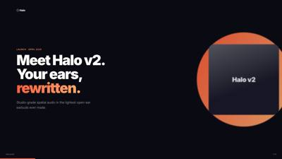</a><br><b>P02</b> 产品发布会</td><td align="center" width="25%"><a href="效果图/P/P03_pitch-deck-vc.jpg">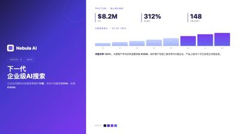</a><br><b>P03</b> VC 路演</td><td align="center" width="25%"><a href="效果图/P/P04_cobalt-sunshine.jpg">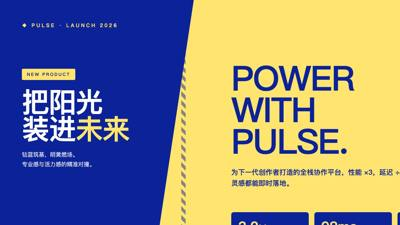</a><br><b>P04</b> 钴蓝阳光</td></tr>
<tr><td align="center" width="25%"><a href="效果图/P/P05_premium-color-blocking.jpg">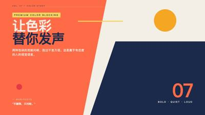</a><br><b>P05</b> 高级撞色</td><td align="center" width="25%"><a href="效果图/P/P06_acid-blue-business.jpg">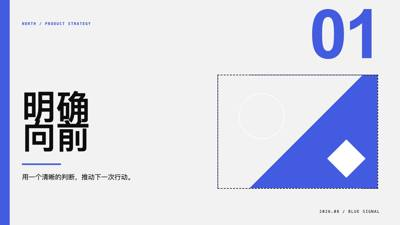</a><br><b>P06</b> 电光蓝商务</td><td align="center" width="25%"><a href="效果图/P/P07_peoples-platform.jpg">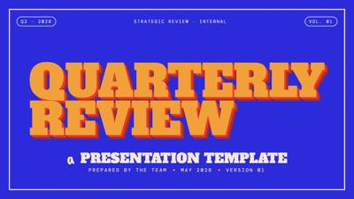</a><br><b>P07</b> 蓝橙大字报</td><td align="center" width="25%"><a href="效果图/P/P08_blue-orange-analytics.jpg">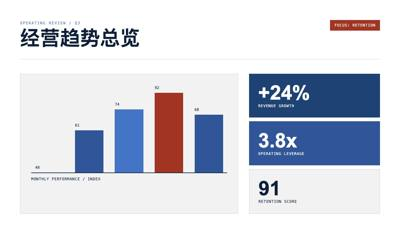</a><br><b>P08</b> 蓝橙数据</td></tr>
<tr><td align="center" width="25%"><a href="效果图/P/P09_bauhaus.jpg">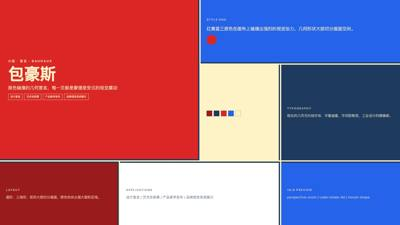</a><br><b>P09</b> 包豪斯</td><td align="center" width="25%"><a href="效果图/P/P10_dopamine-clash.jpg">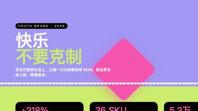</a><br><b>P10</b> 多巴胺撞色</td><td align="center" width="25%"><a href="效果图/P/P11_neon-haze.jpg">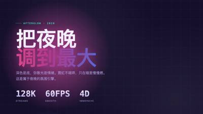</a><br><b>P11</b> 霓虹夜色</td><td align="center" width="25%"><a href="效果图/P/P12_neo-grid-bold.jpg">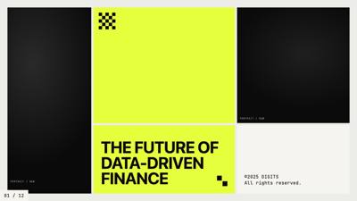</a><br><b>P12</b> 荧光黄网格</td></tr>
<tr><td align="center" width="25%"><a href="效果图/P/P13_splash-abstract.jpg">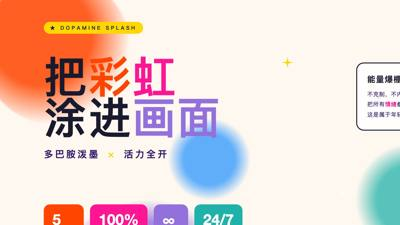</a><br><b>P13</b> 彩虹泼溅</td><td align="center" width="25%"><a href="效果图/P/P14_xhs-white-editorial.jpg"></a><br><b>P14</b> 白底多彩编辑风</td><td align="center" width="25%"><a href="效果图/P/P15_course-module.jpg">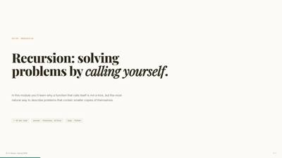</a><br><b>P15</b> course-module</td><td align="center" width="25%"><a href="效果图/P/P16_dir-key-nav-minimal.jpg"></a><br><b>P16</b> dir-key-nav-minimal</td></tr>
<tr><td align="center" width="25%"><a href="效果图/P/P17_graphify-dark-graph.jpg"></a><br><b>P17</b> graphify-dark-graph</td><td align="center" width="25%"><a href="效果图/P/P18_hermes-cyber-terminal.jpg">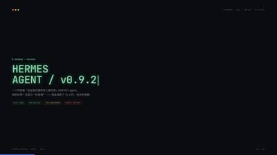</a><br><b>P18</b> hermes-cyber-terminal</td><td align="center" width="25%"><a href="效果图/P/P19_knowledge-arch-blueprint.jpg">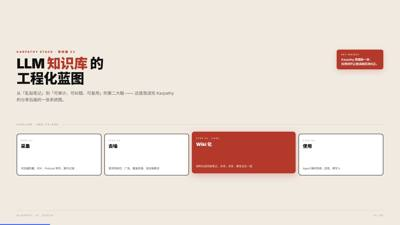</a><br><b>P19</b> knowledge-arch-blueprint</td><td align="center" width="25%"><a href="效果图/P/P20_obsidian-claude-gradient.jpg"></a><br><b>P20</b> obsidian-claude-gradient</td></tr>
<tr><td align="center" width="25%"><a href="效果图/P/P21_presenter-mode-reveal.jpg"></a><br><b>P21</b> presenter-mode-reveal</td><td align="center" width="25%"><a href="效果图/P/P22_tech-sharing.jpg"></a><br><b>P22</b> tech-sharing</td><td align="center" width="25%"><a href="效果图/P/P23_testing-safety-alert.jpg"></a><br><b>P23</b> testing-safety-alert</td><td align="center" width="25%"><a href="效果图/P/P24_weekly-report.jpg">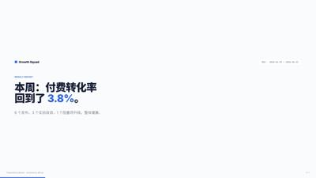</a><br><b>P24</b> weekly-report</td></tr>
<tr><td align="center" width="25%"><a href="效果图/P/P25_xhs-pastel-card.jpg">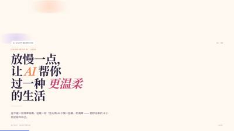</a><br><b>P25</b> xhs-pastel-card</td><td align="center" width="25%"><a href="效果图/P/P26_xhs-post.jpg">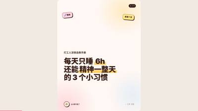</a><br><b>P26</b> xhs-post</td><td align="center" width="25%"><a href="效果图/P/P27_academic-paper.jpg">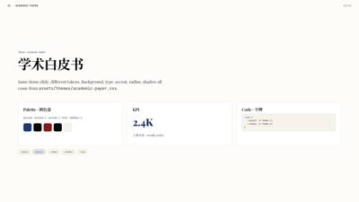</a><br><b>P27</b> 学术白皮书</td><td align="center" width="25%"><a href="效果图/P/P28_arctic-cool.jpg">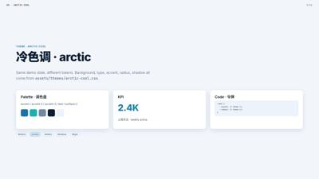</a><br><b>P28</b> 冷色调 · arctic</td></tr>
<tr><td align="center" width="25%"><a href="效果图/P/P29_aurora.jpg">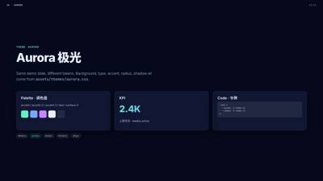</a><br><b>P29</b> Aurora 极光</td><td align="center" width="25%"><a href="效果图/P/P30_bauhaus.jpg">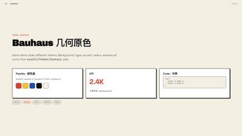</a><br><b>P30</b> Bauhaus 几何原色</td><td align="center" width="25%"><a href="效果图/P/P31_blueprint.jpg">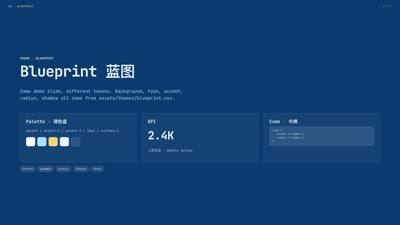</a><br><b>P31</b> Blueprint 蓝图</td><td align="center" width="25%"><a href="效果图/P/P32_catppuccin-latte.jpg">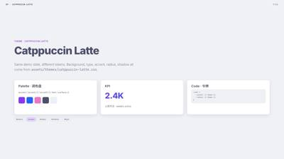</a><br><b>P32</b> Catppuccin Latte</td></tr>
<tr><td align="center" width="25%"><a href="效果图/P/P33_catppuccin-mocha.jpg">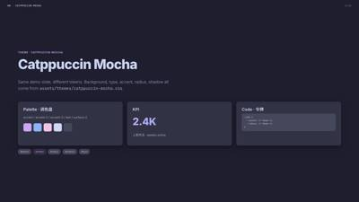</a><br><b>P33</b> Catppuccin Mocha</td><td align="center" width="25%"><a href="效果图/P/P34_corporate-clean.jpg"></a><br><b>P34</b> Corporate Clean 商务</td><td align="center" width="25%"><a href="效果图/P/P35_cyberpunk-neon.jpg">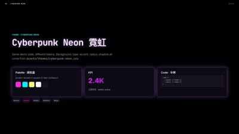</a><br><b>P35</b> Cyberpunk Neon 霓虹</td><td align="center" width="25%"><a href="效果图/P/P36_dracula.jpg">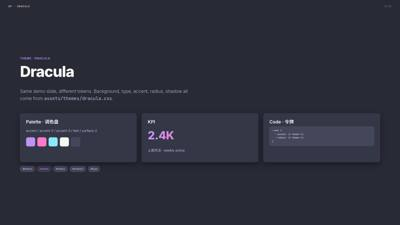</a><br><b>P36</b> Dracula</td></tr>
<tr><td align="center" width="25%"><a href="效果图/P/P37_editorial-serif.jpg">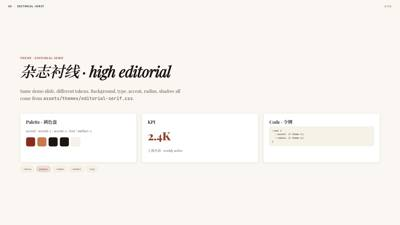</a><br><b>P37</b> 杂志衬线 · high editorial</td><td align="center" width="25%"><a href="效果图/P/P38_engineering-whiteprint.jpg">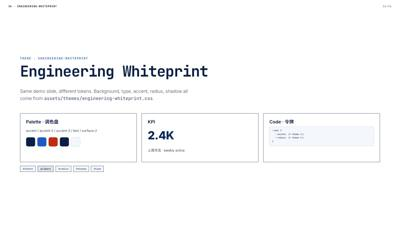</a><br><b>P38</b> Engineering Whiteprint</td><td align="center" width="25%"><a href="效果图/P/P39_glassmorphism.jpg">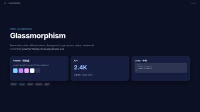</a><br><b>P39</b> Glassmorphism</td><td align="center" width="25%"><a href="效果图/P/P40_gruvbox-dark.jpg">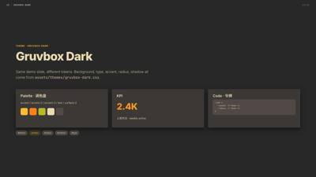</a><br><b>P40</b> Gruvbox Dark</td></tr>
<tr><td align="center" width="25%"><a href="效果图/P/P41_japanese-minimal.jpg">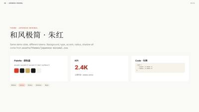</a><br><b>P41</b> 和风极简 · 朱红</td><td align="center" width="25%"><a href="效果图/P/P42_magazine-bold.jpg">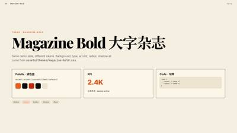</a><br><b>P42</b> Magazine Bold 大字杂志</td><td align="center" width="25%"><a href="效果图/P/P43_memphis-pop.jpg">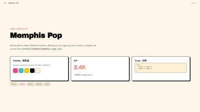</a><br><b>P43</b> Memphis Pop</td><td align="center" width="25%"><a href="效果图/P/P44_midcentury.jpg">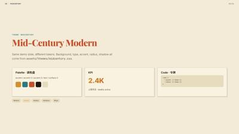</a><br><b>P44</b> Mid-Century Modern</td></tr>
<tr><td align="center" width="25%"><a href="效果图/P/P45_minimal-white.jpg">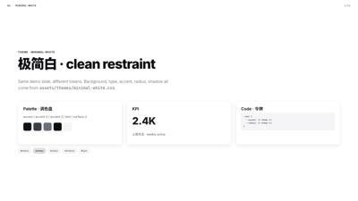</a><br><b>P45</b> 极简白 · clean restraint</td><td align="center" width="25%"><a href="效果图/P/P46_neo-brutalism.jpg">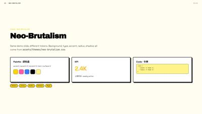</a><br><b>P46</b> Neo-Brutalism</td><td align="center" width="25%"><a href="效果图/P/P47_news-broadcast.jpg">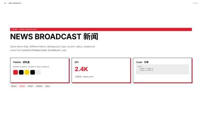</a><br><b>P47</b> News Broadcast 新闻</td><td align="center" width="25%"><a href="效果图/P/P48_nord.jpg">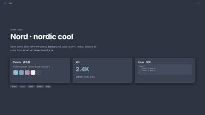</a><br><b>P48</b> Nord · nordic cool</td></tr>
<tr><td align="center" width="25%"><a href="效果图/P/P49_pitch-deck-vc.jpg">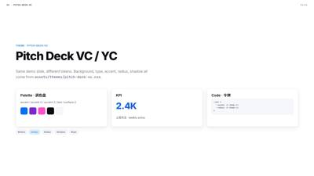</a><br><b>P49</b> Pitch Deck VC / YC</td><td align="center" width="25%"><a href="效果图/P/P50_rainbow-gradient.jpg">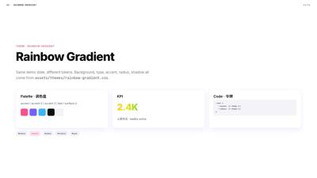</a><br><b>P50</b> Rainbow Gradient</td><td align="center" width="25%"><a href="效果图/P/P51_retro-tv.jpg">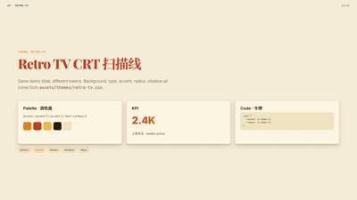</a><br><b>P51</b> Retro TV CRT 扫描线</td><td align="center" width="25%"><a href="效果图/P/P52_rose-pine.jpg">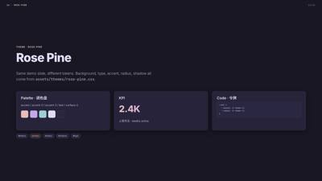</a><br><b>P52</b> Rose Pine</td></tr>
<tr><td align="center" width="25%"><a href="效果图/P/P53_sharp-mono.jpg">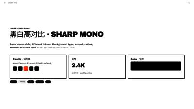</a><br><b>P53</b> 黑白高对比 · sharp mono</td><td align="center" width="25%"><a href="效果图/P/P54_soft-pastel.jpg">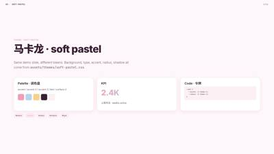</a><br><b>P54</b> 马卡龙 · soft pastel</td><td align="center" width="25%"><a href="效果图/P/P55_solarized-light.jpg">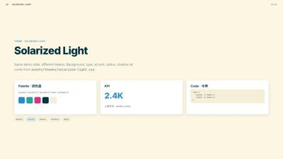</a><br><b>P55</b> Solarized Light</td><td align="center" width="25%"><a href="效果图/P/P56_sunset-warm.jpg">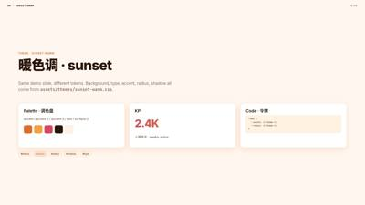</a><br><b>P56</b> 暖色调 · sunset</td></tr>
<tr><td align="center" width="25%"><a href="效果图/P/P57_swiss-grid.jpg">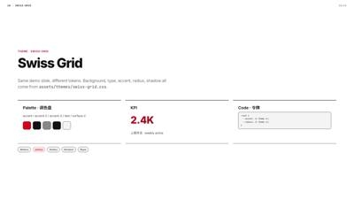</a><br><b>P57</b> Swiss Grid</td><td align="center" width="25%"><a href="效果图/P/P58_terminal-green.jpg">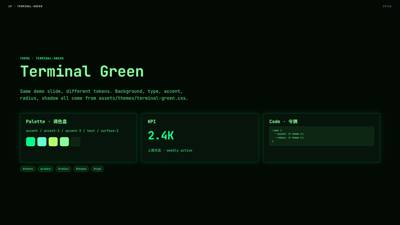</a><br><b>P58</b> Terminal Green</td><td align="center" width="25%"><a href="效果图/P/P59_tokyo-night.jpg"></a><br><b>P59</b> Tokyo Night</td><td align="center" width="25%"><a href="效果图/P/P60_vaporwave.jpg"></a><br><b>P60</b> Vaporwave 蒸汽波</td></tr>
<tr><td align="center" width="25%"><a href="效果图/P/P61_xiaohongshu-white.jpg"></a><br><b>P61</b> 小红书白底</td><td align="center" width="25%"><a href="效果图/P/P62_y2k-chrome.jpg"></a><br><b>P62</b> Y2K Chrome 镜面</td><td align="center" width="25%"><a href="效果图/P/P63_academic-navy.jpg"></a><br><b>P63</b> 藏青学衡</td><td align="center" width="25%"><a href="效果图/P/P64_academic-paper.jpg"></a><br><b>P64</b> 学术论文</td></tr>
<tr><td align="center" width="25%"><a href="效果图/P/P65_amber-aurora.jpg"></a><br><b>P65</b> 扁豆紫蜜陀僧 · 国风治愈</td><td align="center" width="25%"><a href="效果图/P/P66_arctic-cool.jpg"></a><br><b>P66</b> 北极冷</td><td align="center" width="25%"><a href="效果图/P/P67_aurora.jpg"></a><br><b>P67</b> 极光</td><td align="center" width="25%"><a href="效果图/P/P68_blue-white-chart.jpg"></a><br><b>P68</b> 蓝白商务图表</td></tr>
<tr><td align="center" width="25%"><a href="效果图/P/P69_blueprint.jpg"></a><br><b>P69</b> 蓝图</td><td align="center" width="25%"><a href="效果图/P/P70_burgundy-premium.jpg"></a><br><b>P70</b> 勃艮第红高级感</td><td align="center" width="25%"><a href="效果图/P/P71_catppuccin-latte.jpg"></a><br><b>P71</b> Catppuccin 拿铁</td><td align="center" width="25%"><a href="效果图/P/P72_catppuccin-mocha.jpg"></a><br><b>P72</b> Catppuccin 摩卡</td></tr>
<tr><td align="center" width="25%"><a href="效果图/P/P73_celadon-bamboo.jpg"></a><br><b>P73</b> 青瓷竹影</td><td align="center" width="25%"><a href="效果图/P/P74_children-warm-orange.jpg"></a><br><b>P74</b> 童趣橙暖</td><td align="center" width="25%"><a href="效果图/P/P75_chinese-cream-blossom.jpg"></a><br><b>P75</b> 中国传统色·米白樱粉</td><td align="center" width="25%"><a href="效果图/P/P76_chinese-fresh-trio.jpg"></a><br><b>P76</b> 中国传统色·青绿湖蓝</td></tr>
<tr><td align="center" width="25%"><a href="效果图/P/P77_chinese-ink-landscape.jpg"></a><br><b>P77</b> 中式水墨意境·山水</td><td align="center" width="25%"><a href="效果图/P/P78_chinese-pastel-spring.jpg"></a><br><b>P78</b> 中国传统色·春日嫩柳</td><td align="center" width="25%"><a href="效果图/P/P79_chinese-porcelain-rose.jpg"></a><br><b>P79</b> 中国传统色·凝脂杨妃</td><td align="center" width="25%"><a href="效果图/P/P80_classic-duo-blue.jpg"></a><br><b>P80</b> 经典双色·米黄深蓝</td></tr>
<tr><td align="center" width="25%"><a href="效果图/P/P81_corporate-clean.jpg"></a><br><b>P81</b> 企业洁净</td><td align="center" width="25%"><a href="效果图/P/P82_cream-pastel.jpg"></a><br><b>P82</b> 奶油温柔 · 高级感</td><td align="center" width="25%"><a href="效果图/P/P83_cyberpunk-neon.jpg"></a><br><b>P83</b> 赛博霓虹</td><td align="center" width="25%"><a href="效果图/P/P84_dracula.jpg"></a><br><b>P84</b> Dracula 紫</td></tr>
<tr><td align="center" width="25%"><a href="效果图/P/P85_dreamy-pink-gradient.jpg"></a><br><b>P85</b> 渐变美学·樱粉雾蓝</td><td align="center" width="25%"><a href="效果图/P/P86_dreamy-romance.jpg"></a><br><b>P86</b> 梦幻浪漫 · 治愈系</td><td align="center" width="25%"><a href="效果图/P/P87_e-ink-editorial.jpg"></a><br><b>P87</b> 墨页叙事</td><td align="center" width="25%"><a href="效果图/P/P88_editorial-serif.jpg"></a><br><b>P88</b> 杂志衬线</td></tr>
<tr><td align="center" width="25%"><a href="效果图/P/P89_engineering-whiteprint.jpg"></a><br><b>P89</b> 工程白图</td><td align="center" width="25%"><a href="效果图/P/P90_geography-classroom.jpg"></a><br><b>P90</b> 地理课堂·蓝图</td><td align="center" width="25%"><a href="效果图/P/P91_glassmorphism.jpg"></a><br><b>P91</b> 磨砂玻璃</td><td align="center" width="25%"><a href="效果图/P/P92_gold-ivory.jpg"></a><br><b>P92</b> 鎏金象牙 · 高级质感</td></tr>
<tr><td align="center" width="25%"><a href="效果图/P/P93_gradient-cosmic.jpg"></a><br><b>P93</b> 梦幻分界·星河烟火</td><td align="center" width="25%"><a href="效果图/P/P94_gruvbox-dark.jpg"></a><br><b>P94</b> Gruvbox 暗</td><td align="center" width="25%"><a href="效果图/P/P95_hand-drawn-autumn.jpg"></a><br><b>P95</b> 手绘秋日旅行手账</td><td align="center" width="25%"><a href="效果图/P/P96_handdrawn-watercolor.jpg"></a><br><b>P96</b> 治愈手绘水彩</td></tr>
<tr><td align="center" width="25%"><a href="效果图/P/P97_healing-color-card.jpg"></a><br><b>P97</b> 情绪疗愈色卡</td><td align="center" width="25%"><a href="效果图/P/P98_indigo-lotus.jpg"></a><br><b>P98</b> 青莲碧蓝 · 梦幻国风</td><td align="center" width="25%"><a href="效果图/P/P99_industrial-kaizen.jpg"></a><br><b>P99</b> 表格 · 现代周报</td><td align="center" width="25%"><a href="效果图/P/P100_ink-wash-jiangnan.jpg"></a><br><b>P100</b> 水墨江南</td></tr>
<tr><td align="center" width="25%"><a href="效果图/P/P101_japanese-minimal.jpg"></a><br><b>P101</b> 日式极简</td><td align="center" width="25%"><a href="效果图/P/P102_macaron-mist.jpg"></a><br><b>P102</b> 柔雾甜梦</td><td align="center" width="25%"><a href="效果图/P/P103_magazine-bold.jpg"></a><br><b>P103</b> 杂志大字</td><td align="center" width="25%"><a href="效果图/P/P104_memphis-pop.jpg"></a><br><b>P104</b> 孟菲斯波普</td></tr>
<tr><td align="center" width="25%"><a href="效果图/P/P105_midcentury.jpg"></a><br><b>P105</b> 世纪中叶</td><td align="center" width="25%"><a href="效果图/P/P106_minimal-white.jpg"></a><br><b>P106</b> 极简白</td><td align="center" width="25%"><a href="效果图/P/P107_mint-fresh.jpg"></a><br><b>P107</b> 薄荷清新 · 高级绿</td><td align="center" width="25%"><a href="效果图/P/P108_mountain-green-literary.jpg"></a><br><b>P108</b> 山野葱郁</td></tr>
<tr><td align="center" width="25%"><a href="效果图/P/P109_neo-brutalism.jpg"></a><br><b>P109</b> 新野兽派</td><td align="center" width="25%"><a href="效果图/P/P110_news-broadcast.jpg"></a><br><b>P110</b> 新闻播报</td><td align="center" width="25%"><a href="效果图/P/P111_nord.jpg"></a><br><b>P111</b> 北欧</td><td align="center" width="25%"><a href="效果图/P/P112_olive-elegant.jpg"></a><br><b>P112</b> 橄榄奶白 · 高级稳重</td></tr>
<tr><td align="center" width="25%"><a href="效果图/P/P113_orange-sea.jpg"></a><br><b>P113</b> 晴橙落日海</td><td align="center" width="25%"><a href="效果图/P/P114_oriental-poetic-illustration.jpg"></a><br><b>P114</b> 东方意境插画</td><td align="center" width="25%"><a href="效果图/P/P115_palace-ink-red.jpg"></a><br><b>P115</b> 故宫墨红</td><td align="center" width="25%"><a href="效果图/P/P116_rainbow-gradient.jpg"></a><br><b>P116</b> 彩虹渐变</td></tr>
<tr><td align="center" width="25%"><a href="效果图/P/P117_red-gold-ceremony.jpg"></a><br><b>P117</b> 初心红典</td><td align="center" width="25%"><a href="效果图/P/P118_red-research-framework.jpg"></a><br><b>P118</b> 丹朱教研</td><td align="center" width="25%"><a href="效果图/P/P119_retro-tv.jpg"></a><br><b>P119</b> 复古电视</td><td align="center" width="25%"><a href="效果图/P/P120_rose-pine.jpg"></a><br><b>P120</b> 玫瑰松</td></tr>
<tr><td align="center" width="25%"><a href="效果图/P/P121_sage-academia.jpg"></a><br><b>P121</b> 青竹 · 学术风</td><td align="center" width="25%"><a href="效果图/P/P122_sakura-soft-healing.jpg"></a><br><b>P122</b> 樱花治愈</td><td align="center" width="25%"><a href="效果图/P/P123_sharp-mono.jpg"></a><br><b>P123</b> 锐利黑白</td><td align="center" width="25%"><a href="效果图/P/P124_soft-pastel.jpg"></a><br><b>P124</b> 柔和马卡龙</td></tr>
<tr><td align="center" width="25%"><a href="效果图/P/P125_solarized-light.jpg"></a><br><b>P125</b> 日光浅</td><td align="center" width="25%"><a href="效果图/P/P126_song-rain-poetic.jpg"></a><br><b>P126</b> 宋人生活·听雨</td><td align="center" width="25%"><a href="效果图/P/P127_starlight-fireworks.jpg"></a><br><b>P127</b> 一半星河一半烟火</td><td align="center" width="25%"><a href="效果图/P/P128_starry-dust.jpg"></a><br><b>P128</b> 星屑柔光 · 童话感</td></tr>
<tr><td align="center" width="25%"><a href="效果图/P/P129_summer-warm-color.jpg"></a><br><b>P129</b> 夏日暖色</td><td align="center" width="25%"><a href="效果图/P/P130_sunset-warm.jpg"></a><br><b>P130</b> 日落暖</td><td align="center" width="25%"><a href="效果图/P/P131_swiss-grid.jpg"></a><br><b>P131</b> 瑞士网格</td><td align="center" width="25%"><a href="效果图/P/P132_swiss-international.jpg"></a><br><b>P132</b> 瑞士国际主义</td></tr>
<tr><td align="center" width="25%"><a href="效果图/P/P133_terminal-green.jpg"></a><br><b>P133</b> 终端绿</td><td align="center" width="25%"><a href="效果图/P/P134_tokyo-night.jpg"></a><br><b>P134</b> 东京夜</td><td align="center" width="25%"><a href="效果图/P/P135_vaporwave.jpg"></a><br><b>P135</b> 蒸汽波</td><td align="center" width="25%"><a href="效果图/P/P136_xiaohongshu-white.jpg"></a><br><b>P136</b> 小红书白</td></tr>
<tr><td align="center" width="25%"><a href="效果图/P/P137_y2k-chrome.jpg"></a><br><b>P137</b> Y2K 铬</td><td align="center" width="25%"><a href="效果图/P/P138_8-bit-orbit.jpg"></a><br><b>P138</b> 8-Bit Orbit</td><td align="center" width="25%"><a href="效果图/P/P139_biennale-yellow.jpg"></a><br><b>P139</b> Biennale Yellow</td><td align="center" width="25%"><a href="效果图/P/P140_block-frame.jpg"></a><br><b>P140</b> BlockFrame</td></tr>
<tr><td align="center" width="25%"><a href="效果图/P/P141_blue-professional.jpg"></a><br><b>P141</b> Blue Professional</td><td align="center" width="25%"><a href="效果图/P/P142_bold-poster.jpg"></a><br><b>P142</b> Bold Poster</td><td align="center" width="25%"><a href="效果图/P/P143_broadside.jpg"></a><br><b>P143</b> Broadside</td><td align="center" width="25%"><a href="效果图/P/P144_capsule.jpg"></a><br><b>P144</b> Capsule</td></tr>
<tr><td align="center" width="25%"><a href="效果图/P/P145_cartesian.jpg"></a><br><b>P145</b> Cartesian</td><td align="center" width="25%"><a href="效果图/P/P146_cobalt-grid.jpg"></a><br><b>P146</b> Cobalt Grid</td><td align="center" width="25%"><a href="效果图/P/P147_coral.jpg"></a><br><b>P147</b> Coral</td><td align="center" width="25%"><a href="效果图/P/P148_creative-mode.jpg"></a><br><b>P148</b> Creative Mode</td></tr>
<tr><td align="center" width="25%"><a href="效果图/P/P149_daisy-days.jpg"></a><br><b>P149</b> Daisy Days</td><td align="center" width="25%"><a href="效果图/P/P150_editorial-forest.jpg"></a><br><b>P150</b> Editorial Forest</td><td align="center" width="25%"><a href="效果图/P/P151_editorial-tri-tone.jpg"></a><br><b>P151</b> Editorial Tri-Tone</td><td align="center" width="25%"><a href="效果图/P/P152_emerald-editorial.jpg"></a><br><b>P152</b> Emerald Editorial</td></tr>
<tr><td align="center" width="25%"><a href="效果图/P/P153_grove.jpg"></a><br><b>P153</b> Grove</td><td align="center" width="25%"><a href="效果图/P/P154_long-table.jpg"></a><br><b>P154</b> Long Table</td><td align="center" width="25%"><a href="效果图/P/P155_mat.jpg"></a><br><b>P155</b> Mat</td><td align="center" width="25%"><a href="效果图/P/P156_monochrome.jpg"></a><br><b>P156</b> Monochrome</td></tr>
<tr><td align="center" width="25%"><a href="效果图/P/P157_pin-and-paper.jpg"></a><br><b>P157</b> Pin & Paper</td><td align="center" width="25%"><a href="效果图/P/P158_pink-script.jpg"></a><br><b>P158</b> Pink Script — After Hours</td><td align="center" width="25%"><a href="效果图/P/P159_playful.jpg"></a><br><b>P159</b> Playful</td><td align="center" width="25%"><a href="效果图/P/P160_raw-grid.jpg"></a><br><b>P160</b> Raw Grid</td></tr>
<tr><td align="center" width="25%"><a href="效果图/P/P161_retro-windows.jpg"></a><br><b>P161</b> Retro Windows</td><td align="center" width="25%"><a href="效果图/P/P162_retro-zine.jpg"></a><br><b>P162</b> Retro Zine</td><td align="center" width="25%"><a href="效果图/P/P163_sakura-chroma.jpg"></a><br><b>P163</b> Sakura Chroma</td><td align="center" width="25%"><a href="效果图/P/P164_scatterbrain.jpg"></a><br><b>P164</b> Scatterbrain</td></tr>
<tr><td align="center" width="25%"><a href="效果图/P/P165_signal.jpg"></a><br><b>P165</b> Signal</td><td align="center" width="25%"><a href="效果图/P/P166_soft-editorial.jpg"></a><br><b>P166</b> Soft Editorial</td><td align="center" width="25%"><a href="效果图/P/P167_stencil-tablet.jpg"></a><br><b>P167</b> Stencil & Tablet</td><td align="center" width="25%"><a href="效果图/P/P168_studio.jpg"></a><br><b>P168</b> Studio</td></tr>
<tr><td align="center" width="25%"><a href="效果图/P/P169_vellum.jpg"></a><br><b>P169</b> Vellum</td><td align="center" width="25%"><a href="效果图/P/P170_template-swiss.jpg"></a><br><b>P170</b> 瑞士国际主义</td><td align="center" width="25%"><a href="效果图/P/P171_c2-slides-pptx.jpg"></a><br><b>P171</b> 演示稿示例</td></tr>
</table>

## I01–I24　impeccable 视觉世界

<table>
<tr><td align="center" width="25%"><a href="效果图/I/I01_signals-instruments-nixie-laboratory-counter.jpg"></a><br><b>I01</b> 辉光管计数器</td><td align="center" width="25%"><a href="效果图/I/I02_risograph-web-system.jpg"></a><br><b>I02</b> 孔版印刷</td><td align="center" width="25%"><a href="效果图/I/I03_textiles-weave-drape-fashion-industrial-quote-grammar.jpg"></a><br><b>I03</b> 工业引号街头风</td><td align="center" width="25%"><a href="效果图/I/I04_stagecraft-theater-lighting-cyclorama-dawn.jpg"></a><br><b>I04</b> 舞台天幕晨光</td></tr>
<tr><td align="center" width="25%"><a href="效果图/I/I05_dream-surreal-impossible-worlds-alphabet-storm.jpg"></a><br><b>I05</b> 字母风暴</td><td align="center" width="25%"><a href="效果图/I/I06_textiles-weave-drape-fashion-sneaker-box-stacks.jpg"></a><br><b>I06</b> 球鞋鞋盒墙</td><td align="center" width="25%"><a href="效果图/I/I07_vernacular-ephemera-ekiben-wrapper-kiosk.jpg"></a><br><b>I07</b> 车站便当包装</td><td align="center" width="25%"><a href="效果图/I/I08_pop-culture-shelf-insert-card-numbered-series.jpg"></a><br><b>I08</b> 编号收藏卡</td></tr>
<tr><td align="center" width="25%"><a href="效果图/I/I09_signals-instruments-drum-machine-step-row.jpg"></a><br><b>I09</b> 鼓机步进键</td><td align="center" width="25%"><a href="效果图/I/I10_ikeda-datamatics.jpg"></a><br><b>I10</b> 数据崇高（池田亮司）</td><td align="center" width="25%"><a href="效果图/I/I11_galaxies-nebulae-deep-time-accretion-disk-threshold.jpg"></a><br><b>I11</b> 黑洞吸积盘</td><td align="center" width="25%"><a href="效果图/I/I12_reefs-bioluminescent-nocturnal-plankton-wake-stars.jpg"></a><br><b>I12</b> 夜海荧光</td></tr>
<tr><td align="center" width="25%"><a href="效果图/I/I13_medium-native-one-bit-desktop.jpg"></a><br><b>I13</b> 一位元桌面</td><td align="center" width="25%"><a href="效果图/I/I14_scientific-notation-particle-detector-event-display.jpg"></a><br><b>I14</b> 粒子对撞事件图</td><td align="center" width="25%"><a href="效果图/I/I15_design-canon-toyism-signed-collective-plate.jpg"></a><br><b>I15</b> 玩具主义集体画</td><td align="center" width="25%"><a href="效果图/I/I16_pop-culture-shelf-rubber-hose-cel.jpg"></a><br><b>I16</b> 早期动画赛璐珞</td></tr>
<tr><td align="center" width="25%"><a href="效果图/I/I17_signals-instruments-phosphor-terminal-midnight.jpg"></a><br><b>I17</b> 午夜绿屏终端</td><td align="center" width="25%"><a href="效果图/I/I18_medium-native-ascii-live-scene-render.jpg"></a><br><b>I18</b> 字符画实时渲染</td><td align="center" width="25%"><a href="效果图/I/I19_reefs-bioluminescent-nocturnal-chromatophore-skin-language.jpg"></a><br><b>I19</b> 乌贼变色皮肤</td><td align="center" width="25%"><a href="效果图/I/I20_craft-making-coptic-exposed-binding.jpg"></a><br><b>I20</b> 裸脊线装书</td></tr>
<tr><td align="center" width="25%"><a href="效果图/I/I21_pop-culture-shelf-skate-deck-wall.jpg"></a><br><b>I21</b> 滑板店板墙</td><td align="center" width="25%"><a href="效果图/I/I22_posters-covers-sleeves-yeye-pop-sleeve.jpg"></a><br><b>I22</b> 法式流行唱片封套</td><td align="center" width="25%"><a href="效果图/I/I23_posters-covers-sleeves-exploitation-combo-sheet.jpg"></a><br><b>I23</b> 双片联映海报</td><td align="center" width="25%"><a href="效果图/I/I24_pop-culture-shelf-gothic-lolita-mook.jpg"></a><br><b>I24</b> 日式时装杂志跨页</td></tr>
</table>

## T01–T56　taste 配色（只换颜色）

<table>
<tr><td align="center" width="25%"><a href="效果图/T/T01_white-link-blue.jpg"></a><br><b>T01</b> 白纸蓝笔</td><td align="center" width="25%"><a href="效果图/T/T02_cool-white-slate.jpg"></a><br><b>T02</b> 霜白石板</td><td align="center" width="25%"><a href="效果图/T/T03_rose-grey-green.jpg"></a><br><b>T03</b> 玫灰配绿</td><td align="center" width="25%"><a href="效果图/T/T04_paper-grey-brass.jpg"></a><br><b>T04</b> 报纸灰配黄铜</td></tr>
<tr><td align="center" width="25%"><a href="效果图/T/T05_stone-blueprint.jpg"></a><br><b>T05</b> 石灰配蓝图</td><td align="center" width="25%"><a href="效果图/T/T06_white-navy-tab.jpg"></a><br><b>T06</b> 白底藏青</td><td align="center" width="25%"><a href="效果图/T/T07_three-stones.jpg"></a><br><b>T07</b> 三种石色</td><td align="center" width="25%"><a href="效果图/T/T08_putty-black-teal.jpg"></a><br><b>T08</b> 油灰配黑</td></tr>
<tr><td align="center" width="25%"><a href="效果图/T/T09_moss-sand.jpg"></a><br><b>T09</b> 沙配苔绿</td><td align="center" width="25%"><a href="效果图/T/T10_green-mat-chocolate.jpg"></a><br><b>T10</b> 骨白绿巧克力</td><td align="center" width="25%"><a href="效果图/T/T11_lunar-grey-bronze.jpg"></a><br><b>T11</b> 月灰配青铜</td><td align="center" width="25%"><a href="效果图/T/T12_blue-black-cornflower.jpg"></a><br><b>T12</b> 夜黑配矢车菊蓝</td></tr>
<tr><td align="center" width="25%"><a href="效果图/T/T13_green-black-bone.jpg"></a><br><b>T13</b> 墨绿配骨白</td><td align="center" width="25%"><a href="效果图/T/T14_black-crimson.jpg"></a><br><b>T14</b> 黑配深红</td><td align="center" width="25%"><a href="效果图/T/T15_forest-pale-lime.jpg"></a><br><b>T15</b> 森林配浅青柠</td><td align="center" width="25%"><a href="效果图/T/T16_charcoal-room-sage.jpg"></a><br><b>T16</b> 炭黑配灰绿</td></tr>
<tr><td align="center" width="25%"><a href="效果图/T/T17_warm-black-gold.jpg"></a><br><b>T17</b> 暖黑配金</td><td align="center" width="25%"><a href="效果图/T/T18_graphite-safety-orange.jpg"></a><br><b>T18</b> 石墨配安全橙</td><td align="center" width="25%"><a href="效果图/T/T19_soot-pale-lime.jpg"></a><br><b>T19</b> 煤黑配荧光青柠</td><td align="center" width="25%"><a href="效果图/T/T20_plum-black-pink.jpg"></a><br><b>T20</b> 李子黑配亮粉</td></tr>
<tr><td align="center" width="25%"><a href="效果图/T/T21_white-signal-red.jpg"></a><br><b>T21</b> 白底信号红</td><td align="center" width="25%"><a href="效果图/T/T22_white-mint-tiles.jpg"></a><br><b>T22</b> 白灰配薄荷</td><td align="center" width="25%"><a href="效果图/T/T23_cool-grey-cobalt.jpg"></a><br><b>T23</b> 冷灰配钴蓝</td><td align="center" width="25%"><a href="效果图/T/T24_offwhite-bottle-yellow.jpg"></a><br><b>T24</b> 墨绿配亮黄</td></tr>
<tr><td align="center" width="25%"><a href="效果图/T/T25_teal-on-paper.jpg"></a><br><b>T25</b> 纸上墨青</td><td align="center" width="25%"><a href="效果图/T/T26_navy-pink.jpg"></a><br><b>T26</b> 藏青配粉</td><td align="center" width="25%"><a href="效果图/T/T27_blush-aubergine.jpg"></a><br><b>T27</b> 腮红配茄紫</td><td align="center" width="25%"><a href="效果图/T/T28_cobalt-on-sand.jpg"></a><br><b>T28</b> 沙底钴蓝</td></tr>
<tr><td align="center" width="25%"><a href="效果图/T/T29_oxblood-grey.jpg"></a><br><b>T29</b> 牛血红配灰</td><td align="center" width="25%"><a href="效果图/T/T30_olive-on-bone.jpg"></a><br><b>T30</b> 骨白配橄榄</td><td align="center" width="25%"><a href="效果图/T/T31_burgundy-bubblegum.jpg"></a><br><b>T31</b> 酒红配泡泡糖粉</td><td align="center" width="25%"><a href="效果图/T/T32_bottle-green-gold.jpg"></a><br><b>T32</b> 瓶绿配金</td></tr>
<tr><td align="center" width="25%"><a href="效果图/T/T33_cobalt-field.jpg"></a><br><b>T33</b> 满版钴蓝</td><td align="center" width="25%"><a href="效果图/T/T34_mustard-field.jpg"></a><br><b>T34</b> 芥末黄配黑</td><td align="center" width="25%"><a href="效果图/T/T35_carmine-field.jpg"></a><br><b>T35</b> 满版洋红</td><td align="center" width="25%"><a href="效果图/T/T36_pink-field-lime.jpg"></a><br><b>T36</b> 粉配青柠</td></tr>
<tr><td align="center" width="25%"><a href="效果图/T/T37_sky-field-navy.jpg"></a><br><b>T37</b> 天蓝配藏青</td><td align="center" width="25%"><a href="效果图/T/T38_orange-field-black.jpg"></a><br><b>T38</b> 橙配黑</td><td align="center" width="25%"><a href="效果图/T/T39_tobacco-olive.jpg"></a><br><b>T39</b> 烟草配橄榄</td><td align="center" width="25%"><a href="效果图/T/T40_poster-chapters.jpg"></a><br><b>T40</b> 海报章节</td></tr>
<tr><td align="center" width="25%"><a href="效果图/T/T41_blue-red-black.jpg"></a><br><b>T41</b> 蓝红黑</td><td align="center" width="25%"><a href="效果图/T/T42_charcoal-primaries.jpg"></a><br><b>T42</b> 炭黑配三原色</td><td align="center" width="25%"><a href="效果图/T/T43_ultramarine-yellow.jpg"></a><br><b>T43</b> 群青配黄</td><td align="center" width="25%"><a href="效果图/T/T44_candy-chapters.jpg"></a><br><b>T44</b> 糖果章节</td></tr>
<tr><td align="center" width="25%"><a href="效果图/T/T45_orange-sky-lime.jpg"></a><br><b>T45</b> 橙天蓝青柠</td><td align="center" width="25%"><a href="效果图/T/T46_post-red-mustard.jpg"></a><br><b>T46</b> 邮政红配芥末</td><td align="center" width="25%"><a href="效果图/T/T47_mint-orange-grey.jpg"></a><br><b>T47</b> 灰薄荷橙</td><td align="center" width="25%"><a href="效果图/T/T48_report-blocks.jpg"></a><br><b>T48</b> 报告色块</td></tr>
<tr><td align="center" width="25%"><a href="效果图/T/T49_card-pastels.jpg"></a><br><b>T49</b> 卡片粉彩</td><td align="center" width="25%"><a href="效果图/T/T50_mint-pink-accounts.jpg"></a><br><b>T50</b> 薄荷配粉</td><td align="center" width="25%"><a href="效果图/T/T51_swap-pastels.jpg"></a><br><b>T51</b> 轮换粉彩</td><td align="center" width="25%"><a href="效果图/T/T52_blush-sage-slate.jpg"></a><br><b>T52</b> 腮红灰绿石板</td></tr>
<tr><td align="center" width="25%"><a href="效果图/T/T53_candy-on-black.jpg"></a><br><b>T53</b> 黑底糖果色</td><td align="center" width="25%"><a href="效果图/T/T54_sky-sand.jpg"></a><br><b>T54</b> 天蓝配沙</td><td align="center" width="25%"><a href="效果图/T/T55_studio-grey.jpg"></a><br><b>T55</b> 摄影棚灰</td><td align="center" width="25%"><a href="效果图/T/T56_walnut-tan.jpg"></a><br><b>T56</b> 胡桃配棕褐</td></tr>
</table>
